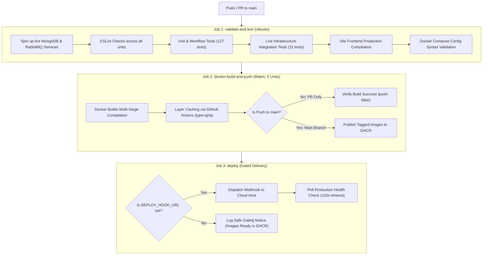

# FinTrack — Production-Style MERN Microservices Platform

[](https://github.com/adityatiwari/fintrack/actions)
[](https://opensource.org/licenses/ISC)
[](https://www.docker.com/)
[](https://www.rabbitmq.com/)

FinTrack is a personal finance tracker application architected using independent microservices, Docker containerization, asynchronous RabbitMQ message-driven alerting, and a GitHub Actions CI/CD pipeline.

---

## 1. System Architecture

FinTrack follows a decoupled microservices architecture with strict domain boundaries and database isolation. The React frontend interacts solely with the API Gateway, which handles authentication verification, rate limiting, and reverse proxy routing.

```mermaid
flowchart TD
    Client["React Frontend (Vite + Tailwind CSS)\nPort: 5173 / 80"]
    Gateway["API Gateway (Express)\n• Rate Limiting • JWT Verification\n• Request ID Propagation\nPort: 8000"]
    
    subgraph Microservices ["Backend Microservices"]
        AuthSvc["Auth Service\n• Register / Login / Refresh / Me\n• JWT Rotation & Bcrypt\nPort: 5001"]
        TxSvc["Transaction Service\n• CRUD & Monthly Summary\n• Event Publisher\nPort: 5002"]
        NotifSvc["Notification Service\n• Threshold Alerts\n• Idempotent Consumer\nPort: 5003"]
    end

    subgraph Broker ["Message Broker"]
        RabbitMQ["RabbitMQ (Topic Exchange)\n• Durable Queues & Persistent Delivery\nPorts: 5672 (AMQP) / 15672 (UI)"]
    end

    subgraph DataStores ["Isolated Databases"]
        AuthDB[("MongoDB (Auth)\nPort: 27018")]
        TxDB[("MongoDB (Transactions)\nPort: 27019")]
        NotifDB[("MongoDB (Notifications)\nPort: 27020")]
    end

    Client -->|HTTPS / API Requests| Gateway
    Gateway -->|/api/auth/*| AuthSvc
    Gateway -->|/api/transactions/* (x-user-id)| TxSvc
    Gateway -->|/api/notifications/* & /api/settings/* (x-user-id)| NotifSvc

    AuthSvc --> AuthDB
    TxSvc --> TxDB
    NotifSvc --> NotifDB

    TxSvc -.->|"Publish (expense.created)\nNon-blocking"| RabbitMQ
    RabbitMQ -.->|"Consume & Ack\nPrefetch: 10"| NotifSvc
```

---

## 2. Services & Port Mapping

| Service | Host Exposure | Container Port | Responsibility | Database |
| :--- | :--- | :--- | :--- | :--- |
| **Frontend** | `5173` (or `80`) [Public] | `80` | React Single Page Application (SPA), Finance Dashboard | None |
| **API Gateway** | `8000` [Public] | `8000` | Single public entry point, CORS, Rate Limit, JWT check & token signing | None |
| **Auth Service** | *Internal Only (No host port)* | `5001` | User registration, login, token rotation, user profile | `fintrack_auth` |
| **Transaction Service** | *Internal Only (No host port)* | `5002` | Transactions CRUD, monthly summaries, RabbitMQ publisher | `fintrack_transactions` |
| **Notification Service**| *Internal Only (No host port)* | `5003` | RabbitMQ consumer, expense threshold alerts, mark-as-read | `fintrack_notifications` |
| **RabbitMQ** | `127.0.0.1:5672` / `15672` (Dev) | `5672` / `15672` | Asynchronous message broker and management UI | Persistent Volume |
| **MongoDB Auth** | `127.0.0.1:27018` (Dev) | `27017` | User records, hashed passwords, hashed refresh tokens | Docker Volume |
| **MongoDB Transactions**| `127.0.0.1:27019` (Dev) | `27017` | User transactions, dates, categories, notes | Docker Volume |
| **MongoDB Notifications**| `127.0.0.1:27020` (Dev) | `27017` | Threshold alerts, read statuses, alert threshold configs | Docker Volume |

---

## 3. RabbitMQ Reliability, Retry Architecture & Broker Justification

### Why RabbitMQ over Redis Pub/Sub and Apache Kafka?

1. **Guaranteed Delivery & Durability**: Unlike Redis Pub/Sub which is purely fire-and-forget (if the notification service drops or restarts during a network glitch, the alert is lost forever), RabbitMQ persists messages to disk in durable queues until explicitly acknowledged (`channel.ack(msg)`).
2. **Decoupled User Experience**: Publishing to RabbitMQ takes less than 2ms. A slow database write in the Notification Service never delays or blocks the user from recording a transaction.
3. **Consumer Idempotency**: Each message contains a unique `transactionId`. The Notification Service enforces a unique compound index on `(userId, transactionId)` in MongoDB. If a duplicate message arrives from the broker or network retry, it is processed idempotently without creating duplicate notifications.
4. **Appropriate Operational Complexity**: Apache Kafka is designed for high-throughput partitioned event streams (millions of events/sec) requiring ZooKeeper/KRaft and heavy memory footprints. For enterprise financial alerting requiring discrete routing and per-message acknowledgment, RabbitMQ provides optimal reliability with low operational overhead.

### Message Processing Pipeline & Reliability Guarantees

- **Publisher Confirms**: The Transaction Service uses an AMQP Confirm Channel (`createConfirmChannel()`). All published messages are durable and await broker persistence confirmation.
- **Main Queue (`notifications_expense_queue`)**: Holds incoming `expense.created` events.
- **Retry Queue with TTL (`notifications_expense_retry_queue`)**: Transient errors (e.g. database timeouts) are routed to a delayed retry queue with a message TTL (default: `5000ms`). After the TTL expires, RabbitMQ automatically dead-letters the message back to the main exchange `fintrack_events` with routing key `expense.created`.
- **Bounded Retries (`MAX_RETRIES: 3`)**: Each retry attempt increments the message's `x-retry-count` header. If a message exceeds `MAX_RETRIES`, it is permanently routed to the Dead-Letter Queue.
- **Dead-Letter Queue (`notifications_expense_dlq`)**: Permanently captures failed messages (e.g. malformed JSON, schema violations, or exhausted retries) along with diagnostic error headers (`x-rejection-reason`, `x-last-error`, `x-failed-at`), preventing poison-pill blocking on worker threads.
- **Connection Recovery & Backoff**: Both publisher and consumer employ bounded exponential backoff reconnection (`delay = min(1000 * 2^(attempt-1), 30000ms)`).
- **Graceful Shutdown**: `SIGTERM` and `SIGINT` signals cleanly close consumers, channels, connections, and database handles.
- **Transactional Outbox Limitation**: In the current Milestone 1 architecture, transaction persistence in MongoDB and RabbitMQ message publication are separate operations. While publisher confirms guarantee durability once received by the broker, a broker outage directly after a database commit can delay or lose the notification event. For Milestone 2 production hardening, the Transactional Outbox pattern (atomic multi-document write + change stream worker) is recommended to achieve guaranteed at-least-once cross-service delivery.

---

## 4. Security & Architecture Principles

- **Zero Direct Microservice Exposure**: The React frontend and external clients communicate **exclusively** with the API Gateway (`http://localhost:8000/api`). Internal microservices have no public host port mappings.
- **Internal Gateway Authentication**: Downstream microservices reject any direct request not bearing a cryptographically valid `x-internal-token` header (`INTERNAL_SERVICE_SECRET`) with HTTP 403 Forbidden (`crypto.timingSafeEqual` comparison).
- **Client Header Sanitization**: The API Gateway automatically strips any client-supplied `x-user-id`, `x-user-email`, or `x-internal-token` headers before processing or proxying requests.
- **In-Memory Access Tokens**: Short-lived JWT access tokens (15m) are held strictly in React application memory. Tokens are never written to `localStorage` or `sessionStorage`, completely mitigating XSS token extraction.
- **HttpOnly Refresh Token Cookies**: Refresh tokens (7d) are stored exclusively in `httpOnly` cookies (`Path=/api/auth`, `SameSite=Lax/Strict`, `Secure=true` in production). JavaScript cannot access the refresh token.
- **Refresh Token Rotation & Reuse Detection**: Every refresh invalidates the used token and issues a new pair. Tokens are stored server-side as SHA-256 hashes (`refreshTokens.tokenHash`). Presenting a consumed token triggers immediate revocation of all active sessions for that user.
- **Multi-Layered CSRF Protection**: Sensitive cookie-authenticated endpoints (`/api/auth/refresh`, `/api/auth/logout`) enforce `Origin` header validation against explicit allowed origins alongside restrictive `SameSite` policies.
- **Strict CORS Policy**: No wildcard origins (`*`) are permitted with credentialed requests. Allowed origins (`http://localhost:5173`, `http://localhost:3000`) are explicitly validated.
- **Concurrent Refresh Batching**: The frontend API client queues and deduplicates concurrent 401 requests into a single in-flight refresh promise, preventing race conditions or multiple rotation calls.
- **Database Isolation**: No service has credentials or access to another service's database.
- **Identity Header Injection**: The API Gateway verifies the JWT access token and securely injects the verified `x-user-id` header downstream.
- **Password & Token Security**: Passwords hashed using `bcrypt` (10 rounds).
- **Zero Hardcoded Secrets**: Docker Compose utilizes `${VAR:?error}` required variable interpolation, failing fast if secrets are missing.
- **Strict Request Validation**: Every write request is validated with `Zod` schemas before controller execution.
- **Request ID Propagation**: Every request receives or generates an `x-request-id` passed through headers to Pino loggers across all downstream services.

---

## 5. Local Setup & Quickstart

### Prerequisites
- [Docker Desktop](https://www.docker.com/) (recommended) OR [Node.js 22 LTS+](https://nodejs.org/) (Node.js >= 22.0.0, npm >= 10.0.0) with local MongoDB and RabbitMQ.

### Option A: Run Entire Stack with Docker Compose (Recommended)

1. **Clone the repository**:
   ```bash
   git clone https://github.com/adityatiwari/fintrack.git
   cd fintrack
   ```

2. **Copy environment configuration**:
   ```bash
   cp .env.example .env
   ```

3. **Start all services with Docker Compose**:
   ```bash
   # Production Hardened Mode (Zero host exposure for DBs or RabbitMQ)
   docker compose up --build

   # Local Development Mode (Exposes loopback DB ports 27018-27020 and RabbitMQ UI 15672 on 127.0.0.1)
   docker compose -f docker-compose.yml -f docker-compose.dev.yml up --build
   ```

4. **Access the application**:
   - Frontend: `http://localhost:5173`
   - API Gateway: `http://localhost:8000`
   - Gateway Health: `http://localhost:8000/health`
   - RabbitMQ Management UI (Dev Mode only): `http://localhost:15672` (Configured in `.env`)
   - Production Deployment Specification: See [`docs/deployment.md`](file:///d:/Aditya%20programs/WD%20Projects/FINTRACK/docs/deployment.md)

---

### Option B: Local Node.js Development

1. **Install dependencies across services**:
   ```bash
   npm --prefix gateway install
   npm --prefix services/auth-service install
   npm --prefix services/transaction-service install
   npm --prefix services/notification-service install
   npm --prefix frontend install
   ```

2. **Run all unit & integration tests**:
   ```bash
   npm test
   ```

3. **Start microservices in development mode**:
   ```bash
   # Terminal 1: API Gateway
   npm --prefix gateway run dev

   # Terminal 2: Auth Service
   npm --prefix services/auth-service run dev

   # Terminal 3: Transaction Service
   npm --prefix services/transaction-service run dev

   # Terminal 4: Notification Service
   npm --prefix services/notification-service run dev

   # Terminal 5: Frontend UI
   npm --prefix frontend run dev
   ```

---

## 6. Seed Demo Account

To populate a complete demo user with transactions spread across October and November 2026:

```bash
npm run seed
```

### Pre-configured Demo Credentials
- **Email**: `demo@fintrack.app`
- **Password**: `Demo@1234`
- **Default Threshold**: `₹10,000`
- **Sample Data**: 15 transactions across 2 months, including Rent, Salary, Consulting, Groceries, Travel, and Shopping (with expenses crossing ₹10,000 triggering automatic alerts).

---

## 7. Running Tests

FinTrack provides a multi-tiered test architecture supporting unit/mock testing, real HTTP gateway integration, and live database/message-broker integration testing.

```bash
# 1. Run all unit, mock, and frontend audit test suites (127 passing tests)
npm test

# 2. Run real infrastructure integration test suite (Live MongoDB, RabbitMQ, and Real HTTP Sockets)
npm run test:integration

# 3. Run entire test suite (Unit + Integration: 158 total automated tests)
npm run test:all

# Individual service unit test suites
npm run test:auth          # 18 tests
npm run test:transaction   # 38 tests (including monetary precision & migration)
npm run test:notification  # 29 tests (including threshold boundary & rabbitmq)
npm run test:gateway       # 20 tests (12 unit/mock + 8 real HTTP integration)
npm run test:frontend      # 22 tests (18 audit scenarios + token storage, concurrent refresh, user workflow)
```

### Test Results Summary
- **Auth Service**: 18/18 passing (Registration, login, cookie rotation, revocation, CORS, internal auth)
- **Transaction Service**: 38/38 passing (CRUD, date filters, monthly summary, integer paise precision, category breakdown, migration idempotency, publisher reliability)
- **Notification Service**: 29/29 passing (Threshold settings, boundary checks, event consumption, idempotency, dead-letter queue, live broker bypass)
- **API Gateway**: 20/20 passing (12 unit/mock + 8 real TCP/HTTP network socket integration tests)
- **Frontend Security & Workflow**: 22/22 passing (18 audit scenarios + zero localStorage token storage, concurrent 401 batching, session expiration, end-to-end user workflow)

---

## 8. Real Infrastructure Integration Testing (Phase C)

### Isolated Test Namespace
Integration tests execute strictly in dedicated test databases and queues to guarantee zero pollution of local development data:
- **Databases**: `fintrack_auth_test`, `fintrack_transactions_test`, `fintrack_notifications_test`
- **Exchanges & Queues**: `fintrack_test_events`, `test_notifications_expense_queue`, `test_notifications_expense_dlq`

### Starting Live Test Infrastructure with Docker
```bash
# 1. Start isolated MongoDB and RabbitMQ test containers
docker run -d --name fintrack-mongo-test -p 27017:27017 mongo:7.0-jammy
docker run -d --name fintrack-rabbit-test -p 5672:5672 -p 15672:15672 rabbitmq:3.13-management-alpine

# 2. Run integration test suite
npm run test:integration

# 3. Teardown test containers after execution
docker stop fintrack-mongo-test fintrack-rabbit-test
docker rm fintrack-mongo-test fintrack-rabbit-test
```

*Note: In environments where Docker or native MongoDB/RabbitMQ daemons are offline, the integration runner automatically detects port unavailability, logs an explicit notice, and marks the live database/broker tests as `NOT TESTED` rather than substituting mocks, preserving test integrity.*

---

## 9. Financial Data Integrity & Integer Paise Architecture

To prevent floating-point inaccuracies (e.g. `0.1 + 0.2 !== 0.3`), FinTrack stores financial amounts internally as **canonical integer paise** (1 INR = 100 paise) while maintaining an external API and UI in Indian Rupees (INR ₹):

- **API Boundary**: Endpoints accept and return INR decimal numbers (e.g. `₹1,250.75`), strictly validating precision up to 2 decimal places. Values with >2 decimal places (e.g. `10.555`) are rejected.
- **Storage**: Mongoose schemas store `amountPaise: 125075` as strict integers.
- **Aggregations**: Monthly totals and balances are calculated using integer arithmetic (`balancePaise = totalIncomePaise - totalExpensePaise`), eliminating floating-point drift.
- **Thresholds**: User alert thresholds are stored in paise (default: `1000000` paise = `₹10,000`), ensuring exact comparison during RabbitMQ event processing.
- **Database Migration (`scripts/migrate-to-paise.js`)**: An idempotent migration script with `--dry-run` support safely converts legacy rupee records into integer paise without double conversion on rerun.

---

## 10. Frontend Functional, UI/UX and Security Audit (Phase D)

The React/Vite frontend underwent a comprehensive 18-scenario functional, UI/UX, and security audit:
- **Authentication & Token Management**: Tokens reside strictly in memory. Any residual `localStorage` or `sessionStorage` tokens are automatically wiped on boot and logout.
- **Session Restoration & Concurrency**: Restores session silently on page load via `httpOnly` refresh token cookie. Multiple simultaneous 401 errors are coalesced into a single refresh request.
- **INR Monetary Formatting**: All financial inputs validate precision to $\le 2$ decimal places. Dashboard cards, transaction history, and charts display formatted INR with Indian comma groupings (`₹1,250.75`).
- **Responsive & Accessible UI**: Responsive Tailwind layout adapts seamlessly to mobile viewports (down to 375px) with no horizontal overflow. Form inputs provide explicit labels, error states, and keyboard focus outlines.
- **Full Verification Suite**: 22 automated frontend tests covering all 18 scenarios (`npm --prefix frontend test`), clean linting across monorepo (`npm run lint`), and 100% production build bundle compilation (`npm --prefix frontend run build`).

---

## 11. CI/CD Pipeline & GitHub Actions Automation

The continuous integration and continuous delivery pipeline is implemented in [`.github/workflows/ci-cd.yml`](file:///d:/Aditya%20programs/WD%20Projects/FINTRACK/.github/workflows/ci-cd.yml):



### Published GHCR Images Matrix
| Service | Package Name | Tags Generated |
| :--- | :--- | :--- |
| **API Gateway** | `ghcr.io/<owner>/fintrack-gateway` | `sha-<short-sha>`, `latest` |
| **Auth Service** | `ghcr.io/<owner>/fintrack-auth-service` | `sha-<short-sha>`, `latest` |
| **Transaction Service** | `ghcr.io/<owner>/fintrack-transaction-service` | `sha-<short-sha>`, `latest` |
| **Notification Service** | `ghcr.io/<owner>/fintrack-notification-service` | `sha-<short-sha>`, `latest` |
| **Frontend UI** | `ghcr.io/<owner>/fintrack-frontend` | `sha-<short-sha>`, `latest` |

### Required GitHub Secrets
Configure under **Repository Settings $\to$ Secrets and variables $\to$ Actions**:

| Secret Name | Purpose | Required / Optional |
| :--- | :--- | :--- |
| `GITHUB_TOKEN` | Automatically provided by GitHub Actions for GHCR authentication. | Built-in (Automatic) |
| `DEPLOY_HOOK_URL` | Webhook URL triggered via HTTP POST to initiate cloud host redeployment. | Optional (Gated) |
| `DEPLOY_HEALTH_CHECK_URL` | Public endpoint (e.g. `https://api.fintrack.app/health`) polled to verify live deployment. | Optional (Gated) |

---

## 12. API Documentation

Complete API documentation is provided in two formats in the [`docs/`](file:///d:/Aditya%20programs/WD%20Projects/FINTRACK/docs) folder:
1. **OpenAPI 3.0 Specification**: [`docs/openapi.yaml`](file:///d:/Aditya%20programs/WD%20Projects/FINTRACK/docs/openapi.yaml) (viewable in Swagger Editor / Postman)
2. **Postman Collection**: [`docs/fintrack.postman_collection.json`](file:///d:/Aditya%20programs/WD%20Projects/FINTRACK/docs/fintrack.postman_collection.json) (import directly into Postman)

---

## 13. Technical Trade-Offs & Future Improvements

1. **Reactive Polling vs WebSockets/SSE**:
   - *Current Implementation*: Real-time alerts are refreshed on user action and backed by a 10s background poll.
   - *Production Enhancement*: Add Server-Sent Events (SSE) or a WebSocket gateway (e.g. Socket.io) hooked into the RabbitMQ consumer for instant browser toasts.
2. **Summary Caching**:
   - *Current Implementation*: MongoDB aggregation queries dynamically calculate monthly totals on demand.
   - *Production Enhancement*: Add Redis caching for monthly summary endpoints (`/transactions/summary?month=YYYY-MM`), invalidating the cache when a transaction is added, edited, or deleted.
3. **Distributed Tracing**:
   - *Current Implementation*: Standardized `x-request-id` propagated across HTTP headers and structured Pino logs.
   - *Production Enhancement*: Integrate OpenTelemetry (OTel) and Jaeger for visual distributed tracing across microservices.

---

## 14. AI Usage Policy Disclosure

In compliance with the assignment instructions:
- **Tools Used**: AI Agent (Google DeepMind Antigravity) for code generation, architectural scaffolding, test suite construction, and documentation.
- **Scope of Usage**:
  - Scaffolding the monorepo directory layout according to assignment specifications.
  - Designing Express microservices with Zod validation and Pino logging.
  - Implementing RabbitMQ publisher and idempotent consumer pipelines.
  - Writing unit and integration tests with Jest and Supertest.
  - Formulating Dockerfiles and GitHub Actions workflow matrices.
- **Ownership & Defense**: The entire architecture, security decisions, database boundaries, and codebase logic have been reviewed, verified, and are fully explainable during technical walkthroughs.

---

## 15. Author & Submission Information

- **Candidate**: Aditya Tiwari
- **Role**: Full Stack Developer
- **Company**: Correm Advisory India Pvt. Ltd.
- **Date**: November 2026
