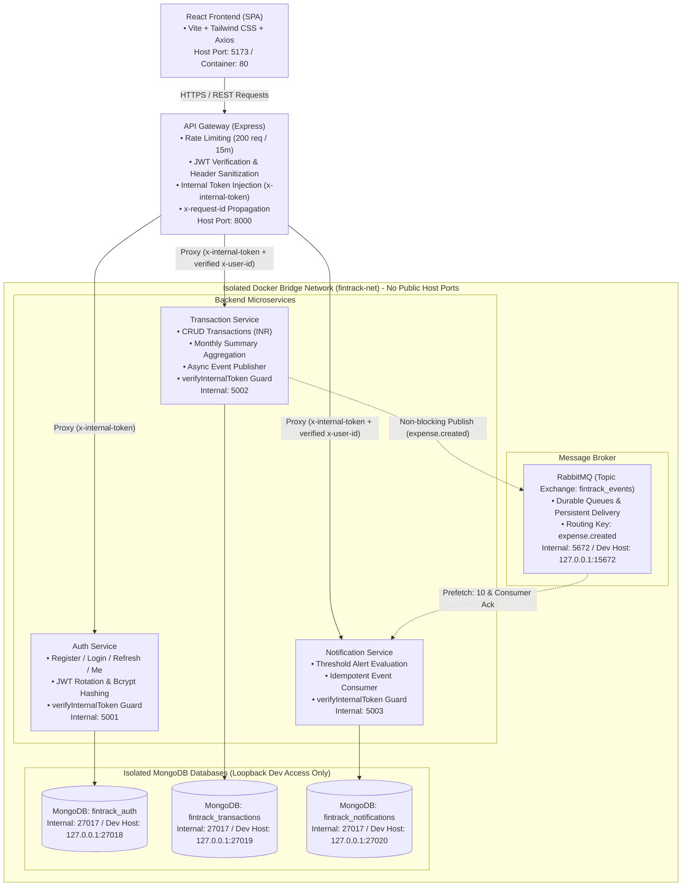
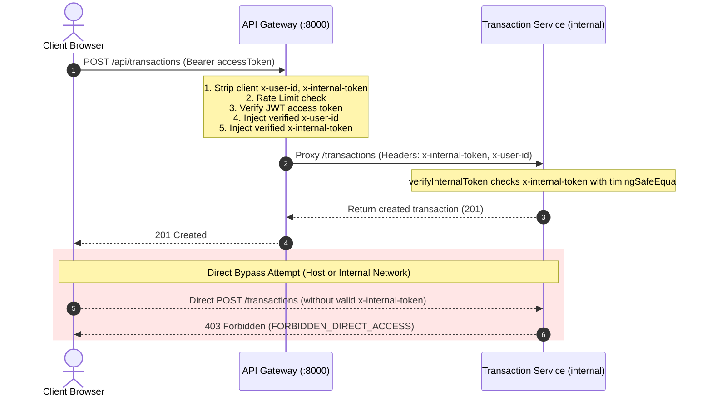
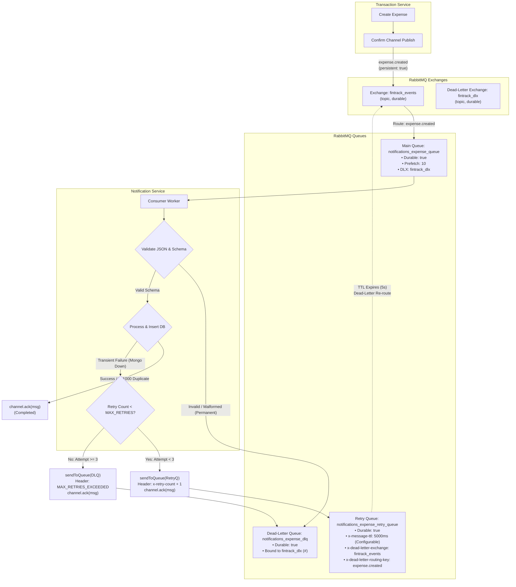

# FinTrack System Architecture & Design Specification

This document details the architectural foundation, boundaries, communication protocols, and deployment lifecycle of **FinTrack**, a production-style MERN microservices personal finance application.

---

## 1. High-Level Architecture Diagram



---

## 2. Five Independent Deployable Units

FinTrack is organized as a monorepo containing five discrete, independently versioned and containerized deployable units:

1. **Frontend (`frontend`)**:
   - Single Page Application built with React 18, Vite, React Router, Axios, and Tailwind CSS.
   - Talks **exclusively** to the API Gateway. Never accesses backend microservices directly.
   - Containerized with multi-stage Docker build served via Alpine Nginx.
2. **API Gateway (`gateway`)**:
   - Single public entry point on port `8000`.
   - Manages Cross-Origin Resource Sharing (CORS), request rate limiting, centralized logging, and reverse proxying.
   - Verifies JWT access tokens, strips client-supplied `x-user-id` headers to prevent spoofing, and securely injects the verified `x-user-id` downstream.
3. **Auth Service (`services/auth-service`)**:
   - Runs on port `5001`.
   - Manages user registration, credential authentication with bcrypt, short-lived JWT access tokens (15m), and refresh token rotation with SHA-256 token hashing.
   - Owns and isolates the `fintrack_auth` MongoDB database.
4. **Transaction Service (`services/transaction-service`)**:
   - Runs on port `5002`.
   - Manages full transaction CRUD, month/type/category filtering, pagination, and monthly summary aggregations in INR (`₹`).
   - Publishes an asynchronous `EXPENSE_CREATED` event to RabbitMQ whenever an expense is created.
   - Owns and isolates the `fintrack_transactions` MongoDB database.
5. **Notification Service (`services/notification-service`)**:
   - Runs on port `5003`.
   - Asynchronously consumes expense events from RabbitMQ without blocking transaction creation.
   - Evaluates whether single expenses exceed user-defined alert thresholds (default ₹10,000) and creates alerts.
   - Guarantees consumer idempotency via unique compound indexing `(userId, transactionId)`.
   - Owns and isolates the `fintrack_notifications` MongoDB database.

---

## 3. Database Isolation Principle

Each microservice strictly owns its dedicated MongoDB datastore:
- `fintrack_auth`: Stores user profiles, password hashes, and hashed refresh tokens.
- `fintrack_transactions`: Stores user transactions with compound indexes on `{ userId: 1, date: -1 }` and `{ userId: 1, type: 1, date: -1 }`.
- `fintrack_notifications`: Stores in-app alerts and user threshold preferences with a unique compound index on `{ userId: 1, transactionId: 1 }`.

**No service ever directly queries another service's database.** All cross-domain collaboration occurs via HTTP proxying or asynchronous RabbitMQ events.

---

## 4. API Gateway Communication & Defense-in-Depth Security

FinTrack implements a strict **defense-in-depth** security architecture combining network isolation and application-layer gateway verification:

### 1. Network Layer Isolation
- Backend microservices (`auth-service`, `transaction-service`, `notification-service`) have **no published host ports** in Docker Compose.
- They are accessible exclusively within the internal Docker bridge network (`fintrack-net`).
- Development databases and message broker ports are restricted strictly to loopback (`127.0.0.1`), never `0.0.0.0`.

### 2. Application Layer Gateway Authentication (`INTERNAL_SERVICE_SECRET`)
- Microservices cannot rely solely on network boundaries: any direct request bypassing the API Gateway is blocked by application middleware.
- The API Gateway signs every forwarded proxy request with an `x-internal-token` header containing a cryptographically secure shared secret (`INTERNAL_SERVICE_SECRET`).
- Each downstream microservice mounts `verifyInternalToken` middleware using `crypto.timingSafeEqual` to prevent timing attacks.
- Direct or spoofed requests lacking a valid internal token are immediately rejected with **HTTP 403 Forbidden** (`FORBIDDEN_DIRECT_ACCESS` or `INVALID_INTERNAL_TOKEN`).
- Public infrastructure health endpoints (`GET /health`) remain unauthenticated so container orchestrators can perform liveness checks.

### 3. Header Sanitization & Anti-Spoofing
- The Gateway automatically strips untrusted incoming headers (`x-user-id`, `x-user-email`, `x-internal-token`) sent by clients.
- Only after successful JWT validation does the Gateway securely inject the verified user identity into downstream proxy requests.



### 4. Secure Token Lifecycle, HttpOnly Cookies & CSRF Protection

```mermaid
sequenceDiagram
    autonumber
    actor Browser as React SPA (Client)
    participant GW as API Gateway (:8000)
    participant Auth as Auth Service (internal)
    participant DB as MongoDB (fintrack_auth)

    rect rgb(240, 248, 255)
    Note over Browser,DB: 1. Login Flow (HttpOnly Cookie Issuance)
    Browser->>GW: POST /api/auth/login { email, password }
    GW->>Auth: Proxy /login (with x-internal-token)
    Auth->>DB: Verify credentials & save hashed refresh token
    Auth-->>GW: 200 OK + Set-Cookie: refreshToken=...; HttpOnly; SameSite; Path=/api/auth<br/>Body: { accessToken: "jwt_15m" }
    GW-->>Browser: Forward 200 OK + Set-Cookie header<br/>Body: { accessToken } (NO refresh token in JSON)
    Note over Browser: Access token stored in JS MEMORY ONLY (never in localStorage)
    end

    rect rgb(245, 255, 245)
    Note over Browser,DB: 2. Automatic Token Refresh on 401 / Page Reload
    Browser->>GW: POST /api/auth/refresh (Cookie: refreshToken=...)
    Note over GW: CSRF Check: Validate Origin against allowedOrigins
    GW->>Auth: Proxy /refresh (Cookie forwarded)
    Auth->>DB: Check hash in DB, rotate token pair
    Auth-->>GW: 200 OK + Set-Cookie: refreshToken=<new_token>; HttpOnly<br/>Body: { accessToken: <new_jwt> }
    GW-->>Browser: Return new accessToken in memory
    Note over Browser: Concurrent 401s deduplicated into a single in-flight refresh promise
    end

    rect rgb(255, 240, 240)
    Note over Browser,DB: 3. Logout & Session Revocation
    Browser->>GW: POST /api/auth/logout (Cookie: refreshToken=...)
    GW->>Auth: Proxy /logout
    Auth->>DB: Revoke token from user.refreshTokens array
    Auth-->>GW: 200 OK + Set-Cookie: refreshToken=; Max-Age=0
    GW-->>Browser: 200 OK + Cookie cleared
    Note over Browser: Memory state wiped
    end
```

#### Token Management Architecture:
- **Access Token**: Short-lived (15 minutes), held strictly in frontend React application memory (`ApiClient.accessToken`). It is never persisted in `localStorage` or `sessionStorage`, eliminating XSS token theft vectors.
- **Refresh Token**: Long-lived (7 days), stored exclusively in an `httpOnly` cookie (`Path=/api/auth`, `SameSite=Lax/Strict`, `Secure=true` in production). JavaScript cannot read or access this cookie.
- **Refresh Token Rotation**: Every refresh consumes the existing token and issues a new one. Stored server-side as SHA-256 hashes (`refreshTokens.tokenHash`). If an already-consumed token is presented (reuse attempt), all active sessions for that user are immediately invalidated.
- **Page Reload Session Restoration**: Upon browser refresh, memory is reinitialized. The application calls `/api/auth/refresh` with `credentials: 'include'`. The browser automatically transmits the `httpOnly` cookie, seamlessly restoring the user's session without querying local browser storage.
- **Multi-Layered CSRF Protection**:
  1. `SameSite=Lax` (dev) / `Strict` (prod) cookie attribute prevents cross-site cookie transmission.
  2. Gateway middleware validates the `Origin` header on sensitive state-changing endpoints (`/api/auth/refresh`, `/api/auth/logout`), rejecting any untrusted cross-origin request with HTTP 403 Forbidden (`CSRF_ORIGIN_INVALID`).
  3. Strict CORS origin whitelist without wildcards prevents unauthorized cross-origin access.

---

## 5. RabbitMQ Reliability, Retry Mechanism & Dead-Letter Pipeline

FinTrack implements an enterprise-grade, asynchronous message pipeline with bounded retries, delayed retry queues, dead-letter routing, consumer idempotency, and publisher confirms.

### 5.1 Architecture & Topology



### 5.2 Message Lifecycle & Processing Flow

1. **Publisher Confirms**:
   - `services/transaction-service/src/services/eventPublisher.js` uses an AMQP Confirm Channel (`createConfirmChannel()`).
   - Every published event is marked `persistent: true` and awaits broker confirmation.
   - Failures to publish do not block user HTTP response (async decoupling), but log critical alerts for ops observability.

2. **Validation & Poison Pill Protection**:
   - **Malformed JSON**: Syntactically invalid payloads are routed directly to `notifications_expense_dlq` with header `x-rejection-reason: MALFORMED_JSON` and acknowledged from the main queue, preventing poisonous infinite loops.
   - **Invalid Schema**: Messages missing required keys (`userId`, `transactionId`) or carrying non-positive/non-number amounts are routed directly to the DLQ with `x-rejection-reason: INVALID_EVENT_SCHEMA`.

3. **Bounded Retries with TTL Delay**:
   - Transient failures (e.g. temporary MongoDB connection timeouts) are retried up to `MAX_RETRIES` (default `3` attempts).
   - Rather than immediate `nack(requeue=true)` (which causes CPU-spinning tight loops), the message is buffered in `notifications_expense_retry_queue`.
   - The retry queue enforces `x-message-ttl` (default `5000ms`), after which RabbitMQ dead-letters the message back to `fintrack_events` with routing key `expense.created`.
   - Each retry increments the `x-retry-count` header and logs failure telemetry.
   - Once retries reach `MAX_RETRIES`, the message is permanently diverted to `notifications_expense_dlq` with reason `MAX_RETRIES_EXCEEDED`.

4. **Idempotency Guarantee**:
   - MongoDB collection `notifications` enforces a compound unique index on `{ userId: 1, transactionId: 1 }`.
   - In the event of network replays or consumer retries, MongoDB emits error code `11000` (duplicate key).
   - The consumer catches `11000`, logs an idempotent ignore, and acknowledges the message immediately without triggering retries or alerts.

5. **Connection Recovery & Graceful Shutdown**:
   - Reconnection logic in both publisher and consumer employs bounded exponential backoff (`delay = min(1000 * 2^(attempt-1), 30000ms)`).
   - Process signal handlers (`SIGTERM`, `SIGINT`) cleanly close consumers, channels, connections, and database handles.

### 5.3 Architectural Limitation: Dual-Write & The Transactional Outbox Pattern

In the current FinTrack release (Milestone 1), asynchronous event propagation between the Transaction Service and Notification Service operates under the following architectural trade-offs:

1. **Non-Atomic Dual-Write Boundary**:
   - Transaction persistence (in MongoDB `fintrack_transactions`) and RabbitMQ event publication (`EXPENSE_CREATED` on topic exchange `fintrack_events`) are currently **separate operations**.
   - The application does not span MongoDB and RabbitMQ under a two-phase distributed commit protocol (2PC).

2. **Broker Disconnection Impact**:
   - If the RabbitMQ broker is unreachable, crashes, or suffers a network partition immediately after MongoDB has committed `transaction.save()`, the transaction is safely persisted but event publication fails.
   - While the HTTP transaction creation endpoint succeeds without crashing or blocking the client, the corresponding notification event is delayed or lost without an outbox retry store.

3. **Publisher Confirms vs. Database Atomicity**:
   - The Transaction Service leverages AMQP **Publisher Confirms** (`channel.waitForConfirms()` with persistent message delivery). This guarantees that *if* RabbitMQ receives the message, the broker persists it to disk before acknowledging.
   - However, Publisher Confirms **do not make the MongoDB database write and RabbitMQ message publication atomic**. A failure between the database write and the network publish remains vulnerable to message loss.

4. **Recommended Future Reliability Improvement (Transactional Outbox)**:
   - For Milestone 2 production hardening, the recommended architectural enhancement is the **Transactional Outbox Pattern**:
     - Inside a single MongoDB multi-document ACID transaction (`session.withTransaction()`), both the `Transaction` entity and an `OutboxEvent` document are persisted atomically.
     - A background outbox poller or MongoDB Change Stream worker tails the outbox collection and safely publishes events to RabbitMQ with exponential backoff.
     - Once published and confirmed by RabbitMQ, the outbox record is marked processed or purged, guaranteeing strictly **at-least-once event delivery** across broker and process outages.

---

## 6. Planned CI/CD Pipeline Workflow

Continuous Integration and Continuous Delivery is orchestrated through GitHub Actions (`.github/workflows/ci-cd.yml`):

1. **Lint & Test**: Matrix strategy across all backend services (`auth-service`, `transaction-service`, `notification-service`, `gateway`) executing Jest & Supertest test suites.
2. **Frontend Build**: Validates React + Vite production compilation.
3. **Container Build**: Multi-platform Docker Buildx builds lean Alpine images with layer caching (`cache-from: type=gha`).
4. **Publish to GHCR**: Merges to `main` push container images to GitHub Container Registry (`ghcr.io/<owner>/fintrack-<service>:latest`).
5. **Automated Deployment**: Dispatches deploy webhook trigger (`DEPLOY_HOOK_URL`) to cloud host (Render, Railway, Fly.io, or VPS).


---

## 7. Financial Data Integrity & Integer Paise Architecture (Phase B4)

To prevent IEEE 754 floating-point inaccuracies (e.g. `0.1 + 0.2 = 0.30000000000000004` or fractional rupee truncation), FinTrack standardizes on **canonical integer paise** internal representation while preserving a seamless Indian Rupee (INR ₹) interface at the API boundary.

### 7.1 Canonical Representation vs. Boundary Compatibility

| Dimension | External Boundary (API / Frontend) | Internal Storage & Calculation |
| :--- | :--- | :--- |
| **Unit** | Indian Rupee (INR ₹) | Integer Paise (1 INR = 100 paise) |
| **Precision** | Max 2 decimal places (strict validation) | Strict JavaScript Safe Integer (`Number.isSafeInteger`) |
| **Sample Value** | `1250.75` | `125075` |
| **Default Threshold**| `₹10,000` | `1000000` |

### 7.2 Service-Level Implementation

1. **Transaction Service**:
   - Schema: `amountPaise: { type: Number, required: true, validate: Number.isInteger }`.
   - Validation: Zod strictly validates amounts as positive numbers and rejects inputs with >2 decimal places.
   - Serialization: `toJSON()` transforms `amountPaise / 100` into `amount` (INR) and strips internal `amountPaise` from public JSON responses.
   - Aggregations: MongoDB `$group` sums `$amountPaise`. Balance is calculated as exact integer difference `totalIncomePaise - totalExpensePaise`. Resulting sums are converted to INR via `toRupees()` only at the response boundary.
   - Event Publishing: Emits both `amount` (INR) and `amountPaise` (integer) in RabbitMQ `EXPENSE_CREATED` events.

2. **Notification Service**:
   - Schema: `thresholdPaise: { type: Number, required: true }` and `amountPaise: { type: Number, required: true }`.
   - Threshold API: Accepts and returns decimal INR at the REST boundary, converting to `thresholdPaise` on write.
   - Event Consumer: Compares `expensePaise >= thresholdPaise` purely using exact integer math.
   - Serialization: `toJSON()` exposes `threshold` and `amount` in INR while hiding internal paise fields.

3. **Database Migration Tool (`scripts/migrate-to-paise.js`)**:
   - Converts existing records (`transactions`, `thresholds`, `notifications`) from rupee numbers to integer paise.
   - **Idempotency Guarantee**: Scans only documents where `amountPaise` / `thresholdPaise` does not exist or is null. Re-running the script skips already-migrated documents without double conversion.
   - Supports `--dry-run` to preview transformations before modifying database records.


---

## 8. Integration Testing Architecture & Isolation (Phase C)

### 8.1 Unit Tests vs. Real Infrastructure Integration Tests

FinTrack maintains a strict two-tier automated testing strategy:

1. **Unit & In-Memory Mock Tests (`npm test`)**:
   - Fast, deterministic, and isolated.
   - Runs on developer machines and in minimal CI environments without external daemon dependencies.
   - Exercises business logic, Zod schema validations, controller response shapes, JWT rotation mechanics, and integer paise conversion utilities.

2. **Real Infrastructure Integration Tests (`npm run test:integration`)**:
   - Executes real queries, real unique compound index constraints (`E11000`), real aggregation pipelines (`$group` on `$amountPaise`), and real AMQP message exchange routing against live infrastructure.
   - API Gateway tests run against real ephemeral TCP HTTP sockets (`http.createServer(app).listen(0)`), verifying genuine network proxying, request ID propagation, and header sanitization.

### 8.2 Test Environment Isolation & Namespacing

To guarantee zero interference with local development databases or message queues, integration tests execute strictly within dedicated test namespaces:

| Resource | Development Environment | Integration Test Environment |
| :--- | :--- | :--- |
| **Auth Database** | `mongodb://localhost:27017/fintrack_auth` | `mongodb://localhost:27017/fintrack_auth_test` |
| **Transaction Database**| `mongodb://localhost:27017/fintrack_transactions` | `mongodb://localhost:27017/fintrack_transactions_test` |
| **Notification Database**| `mongodb://localhost:27017/fintrack_notifications`| `mongodb://localhost:27017/fintrack_notifications_test` |
| **RabbitMQ Exchange** | `fintrack_events` | `fintrack_test_events` |
| **RabbitMQ DLX** | `fintrack_dlx` | `fintrack_test_dlx` |
| **RabbitMQ Queue** | `notifications_expense_queue` | `test_notifications_expense_queue` |
| **RabbitMQ DLQ** | `notifications_expense_dlq` | `test_notifications_expense_dlq` |

### 8.3 Starting Live Test Infrastructure

To execute real infrastructure tests locally using Docker:

```bash
# Start isolated MongoDB and RabbitMQ test services
docker run -d --name fintrack-mongo-test -p 27017:27017 mongo:7.0-jammy
docker run -d --name fintrack-rabbit-test -p 5672:5672 -p 15672:15672 rabbitmq:3.13-management-alpine

# Execute real integration test suite
npm run test:integration

# Teardown test containers after execution
docker stop fintrack-mongo-test fintrack-rabbit-test
docker rm fintrack-mongo-test fintrack-rabbit-test
```

### 8.4 Cleanup Procedure & Graceful Handling

- **Database Cleanup**: All test collections in `fintrack_*_test` databases are purged in `afterAll` hooks via `deleteMany({})`.
- **Broker Cleanup**: Temporary queues and exchanges in `fintrack_test_*` are deleted and channels closed gracefully in `afterAll`.
- **Infrastructure Absence Handling**: When Docker / native MongoDB / RabbitMQ are offline on the test runner host, the test suite detects port unavailability via TCP probe (`tests/integration/infra-check.js`), logs a transparent notice, and marks the real database/broker tests as `NOT TESTED` rather than substituting mocks.

---

## 9. Frontend Architecture, UI/UX & Security Audit (Phase D)

### 9.1 Core Frontend Principles
- **API Isolation**: All requests target the API Gateway (`http://localhost:8000/api`). Internal microservices are never referenced or reached directly.
- **Strict In-Memory Token Handling**: Access tokens are held exclusively in React JavaScript memory. No tokens are written to `localStorage` or `sessionStorage`.
- **Silent Session Restoration**: On page reload or initial application boot, the frontend calls `/auth/refresh` using the browser's `httpOnly` cookie to seamlessly restore the authenticated session.
- **Request Batching & Concurrency**: The `ApiClient` coalesces concurrent 401 responses into a single in-flight `refreshPromise`, preventing race conditions or duplicate token rotations.
- **Paise Precision & Indian Currency Formatting**: Transactions accept and validate decimal INR amounts to $\le 2$ decimal places. Stored as canonical integer paise in backend databases, amounts are formatted using Indian comma grouping (`₹1,250.75`).
- **Responsive & Accessible Design**: UI adapts across desktop, tablet, and mobile (down to 375px) without horizontal scrolling. Components provide explicit labels, error states, and keyboard focus outlines.

### 9.2 Audit Verification Suite
- **18 Audit Scenarios Tested**: Validated across Registration, Login, Session Restoration, 401 Refresh, Logout, Dashboard Summaries, Transaction CRUD, Filtering, Pagination, INR formatting, Notifications, and Error States.
- **Automated Test Run**: `npm --prefix frontend test` passes 22 tests across 3 suites.
- **Zero-Warning Production Build**: `npm --prefix frontend run build` bundles the application via Vite with 100% module transformation and zero build errors.
