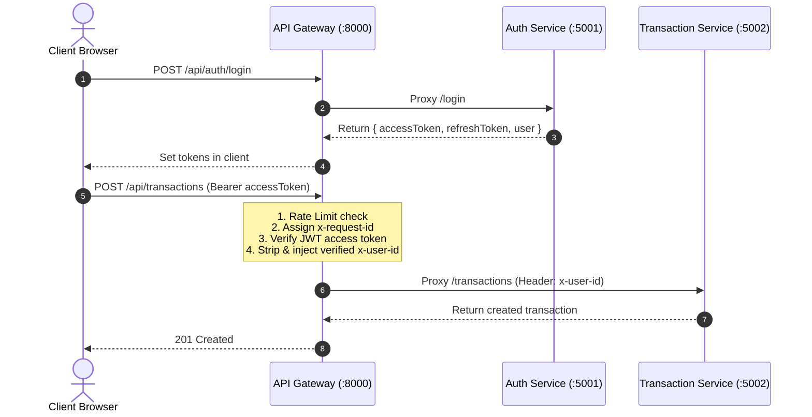
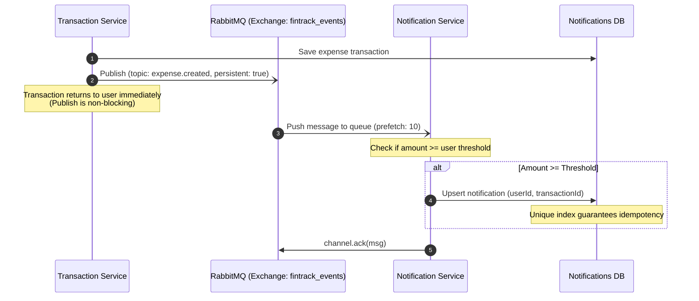

# FinTrack System Architecture & Design Specification

This document details the architectural foundation, boundaries, communication protocols, and deployment lifecycle of **FinTrack**, a production-style MERN microservices personal finance application.

---

## 1. High-Level Architecture Diagram

```mermaid
flowchart TD
    Client["React Frontend (SPA)\n• Vite + Tailwind CSS + Axios\nHost Port: 5173 / Container: 80"]
    
    Gateway["API Gateway (Express)\n• Rate Limiting (200 req / 15m)\n• JWT Verification & Identity Stripping\n• x-request-id Propagation\nPort: 8000"]

    subgraph Microservices ["Independent Backend Microservices"]
        AuthSvc["Auth Service\n• Register / Login / Refresh / Me\n• JWT Rotation & Bcrypt Hashing\nPort: 5001"]
        TxSvc["Transaction Service\n• CRUD Transactions (INR)\n• Monthly Summary Aggregation\n• Async Event Publisher\nPort: 5002"]
        NotifSvc["Notification Service\n• Threshold Alert Evaluation\n• Idempotent Event Consumer\nPort: 5003"]
    end

    subgraph Broker ["Message Broker"]
        RabbitMQ["RabbitMQ (Topic Exchange: fintrack_events)\n• Durable Queues & Persistent Delivery\n• Routing Key: expense.created\nPorts: 5672 (AMQP) / 15672 (UI)"]
    end

    subgraph DataStores ["Isolated MongoDB Databases"]
        AuthDB[("MongoDB: fintrack_auth\nPort: 27018\n• Users & Refresh Token Hashes")]
        TxDB[("MongoDB: fintrack_transactions\nPort: 27019\n• Transactions (Compound Indexes)")]
        NotifDB[("MongoDB: fintrack_notifications\nPort: 27020\n• Notifications & User Thresholds")]
    end

    Client -->|HTTPS REST Requests| Gateway
    Gateway -->|/api/auth/*| AuthSvc
    Gateway -->|/api/transactions/* (Injected x-user-id)| TxSvc
    Gateway -->|/api/notifications/* & /api/settings/* (Injected x-user-id)| NotifSvc

    AuthSvc --> AuthDB
    TxSvc --> TxDB
    NotifSvc --> NotifDB

    TxSvc -.->|"Non-blocking Publish (expense.created)"| RabbitMQ
    RabbitMQ -.->|"Prefetch: 10 & Consumer Ack"| NotifSvc
```

---

## 2. Five Independent Deployable Units

FinTrack is organized as a monorepo containing five discrete, independently versioned and containerized deployable units:

1. **Frontend (`frontend`)**:
   - Single Page Application built with React 18, Vite, React Router, Axios, and Tailwind CSS.
   - Talks **exclusively** to the API Gateway. Never accesses backend microservices directly.
   - Containerized with multi-stage Docker build served via Alpine Nginx.
2. **API Gateway (`gateway`)**:
   - Single public entry point on port `8000`.
   - Manages Cross-Origin Resource Sharing (CORS), request rate limiting, centralized logging, and reverse proxying.
   - Verifies JWT access tokens, strips client-supplied `x-user-id` headers to prevent spoofing, and securely injects the verified `x-user-id` downstream.
3. **Auth Service (`services/auth-service`)**:
   - Runs on port `5001`.
   - Manages user registration, credential authentication with bcrypt, short-lived JWT access tokens (15m), and refresh token rotation with SHA-256 token hashing.
   - Owns and isolates the `fintrack_auth` MongoDB database.
4. **Transaction Service (`services/transaction-service`)**:
   - Runs on port `5002`.
   - Manages full transaction CRUD, month/type/category filtering, pagination, and monthly summary aggregations in INR (`₹`).
   - Publishes an asynchronous `EXPENSE_CREATED` event to RabbitMQ whenever an expense is created.
   - Owns and isolates the `fintrack_transactions` MongoDB database.
5. **Notification Service (`services/notification-service`)**:
   - Runs on port `5003`.
   - Asynchronously consumes expense events from RabbitMQ without blocking transaction creation.
   - Evaluates whether single expenses exceed user-defined alert thresholds (default ₹10,000) and creates alerts.
   - Guarantees consumer idempotency via unique compound indexing `(userId, transactionId)`.
   - Owns and isolates the `fintrack_notifications` MongoDB database.

---

## 3. Database Isolation Principle

Each microservice strictly owns its dedicated MongoDB datastore:
- `fintrack_auth`: Stores user profiles, password hashes, and hashed refresh tokens.
- `fintrack_transactions`: Stores user transactions with compound indexes on `{ userId: 1, date: -1 }` and `{ userId: 1, type: 1, date: -1 }`.
- `fintrack_notifications`: Stores in-app alerts and user threshold preferences with a unique compound index on `{ userId: 1, transactionId: 1 }`.

**No service ever directly queries another service's database.** All cross-domain collaboration occurs via HTTP proxying or asynchronous RabbitMQ events.

---

## 4. API Gateway Communication & Security



---

## 5. Asynchronous RabbitMQ Event Flow



---

## 6. Planned CI/CD Pipeline Workflow

Continuous Integration and Continuous Delivery is orchestrated through GitHub Actions (`.github/workflows/ci-cd.yml`):

1. **Lint & Test**: Matrix strategy across all backend services (`auth-service`, `transaction-service`, `notification-service`, `gateway`) executing Jest & Supertest test suites.
2. **Frontend Build**: Validates React + Vite production compilation.
3. **Container Build**: Multi-platform Docker Buildx builds lean Alpine images with layer caching (`cache-from: type=gha`).
4. **Publish to GHCR**: Merges to `main` push container images to GitHub Container Registry (`ghcr.io/<owner>/fintrack-<service>:latest`).
5. **Automated Deployment**: Dispatches deploy webhook trigger (`DEPLOY_HOOK_URL`) to cloud host (Render, Railway, Fly.io, or VPS).
